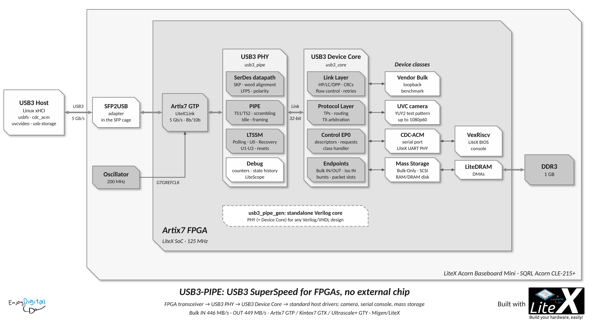

```
                         __  _________  ____    ___  _______  ____
                        / / / / __/ _ )|_  /___/ _ \/  _/ _ \/ __/
                       / /_/ /\ \/ _  |/_ <___/ ___// // ___/ _/
                       \____/___/____/____/  /_/  /___/_/  /___/
                             Copyright (c) 2019-2026, EnjoyDigital
                                      Powered by LiteX
```
[](https://github.com/enjoy-digital/usb3_pipe/actions/workflows/ci.yml)


[> Intro
--------


USB3-PIPE provides **USB 3.2 SuperSpeed (Gen 1x1, 5Gbps) and SuperSpeedPlus (Gen 2x1, 10Gbps) for
FPGAs without any external USB chip**: the FPGA transceivers are directly connected to the USB3
connector, the PHY (USB3 PIPE + LTSSM) and a complete USB3 Device Core (Link/Protocol layers,
endpoints, device classes) are implemented in the fabric, in Migen/LiteX.

Other USB3 solutions for FPGAs rely on an external PHY ([TI TUSB1310A](http://www.ti.com/product/TUSB1310A))
or an external USB controller/FIFO ([FTDI FT60X](https://ftdichip.com/products/ft600q-b/), Infineon
[FX3](https://www.infineon.com/cms/en/product/universal-serial-bus/usb-peripheral-controllers-for-superspeed/ez-usb-fx3-usb-5-gbps-peripheral-controller/)).

**Status** (USB device, SFP2USB adapter, Linux xHCI host):

| | Gen 1x1 (5Gbps): Acorn CLE-215+ (Artix7 GTP) | Gen 2x1 (10Gbps): Alibaba XCKU3P (UltraScale+ GTY) |
|---|---|---|
| Enumeration | SuperSpeed (5000M) | SuperSpeedPlus (10000M), SuperSpeedPlus BOS capability |
| Bulk IN/OUT | 446/449 MB/s (~90% of 5Gbps 8b/10b) | 426/466 MB/s (32-bit link), 744-785/~880 MB/s (64-bit link) |
| Full duplex | 376 + 400 MB/s | 325 + 430 MB/s (32-bit link), 619 + 736 MB/s (64-bit link) |
| Stability | 139 GB full duplex, data checked: 0 errors, no retry/Recovery | 156 GB full duplex (64-bit link), data checked: 0 errors, 0 LBAD, 0 Recovery |
| Suspend/Resume | Linux autosuspend (U3) and resume: 72/72 clean resumes (~0.6s) | |

Standard Linux drivers (usbfs, cdc_acm, uvcvideo, usb-storage). Demos: Bulk loopback/benchmark, LiteX
BIOS console (CDC-ACM), UVC camera up to 1080p60 (Bulk) or 1080p30 (Isochronous), Mass Storage RAM
disk (and DDR3 disk), composite camera + console.

[> Features
-----------
- **PHY** (`usb3_pipe/`): Artix7 GTP/Kintex7 GTX/UltraScale+ GTY SerDes (LiteICLink), LFPS, Training
  Sequences, 8b/10b, scrambling, SKP insertion/removal, word/framing alignment, polarity, LTSSM
  (Polling/U0/Recovery/U1-U3/Hot/Warm Reset/Compliance/Loopback), debug counters. **Gen 2x1** on
  UltraScale+ GTY: SuperSpeedPlus Polling (SCD/LBPM), 128b/132b blocks, Gen 2 scrambler/SKP/SYNC,
  Gen 2 packet framing, optional 64-bit Link Layer interface (`link_words=2`). Also generated as a
  standalone Verilog core (`usb3_pipe_gen`, Artix7/Kintex7/UltraScale+).
- **USB3 Device Core** (`usb3_core/`): Link Layer (header flow control, retries, LMPs, timers,
  SuperSpeedPlus operation: 4-bit sequence numbers, Type 1/Type 2 buffers and credits), Protocol
  Layer, Control Endpoint (standard requests, alternate settings, class/vendor request handler,
  Wishbone bridge), Bulk IN/OUT endpoints with bursts (32 or 64-bit datapaths), Isochronous IN
  endpoints, U1/U2 Link Power Management (`with_lpm`, off by default), descriptors builder, Header
  Packets/Link Layer traces (debug).
- **Device classes**: vendor Bulk, CDC-ACM (serial port/LiteX console), UVC (video camera, Bulk or
  Isochronous), MSC (mass storage on block RAM or DRAM, ex: DDR3 through LiteDRAM), composite devices.
- **Simulation**: Verilator Host model <-> PHYs <-> Device Core (`sim.py`, Gen 1 and Gen 2), Migen
  unit/system tests with Python host models (~390 tests).



[> Hardware
-----------
- [LiteX Acorn Baseboard](https://github.com/enjoy-digital/litex-acorn-baseboard) (Mini) with an Acorn
  CLE-215+ (`bench/acorn.py`, main development/validation target).
- Alibaba Cloud XCKU3P board (`bench/alibaba_xcku3p.py`, Kintex UltraScale+ GTY, SFP2USB adapter in
  the NIC1 SFP cage): validated on hardware at Gen 1 (IN 446MB/s, OUT 450MB/s) and at **Gen 2**
  (`--gen2-capable`, on a USB 3.2 Gen 2 host port), 0 errors. Main Gen 2 development target.
- [KC705](https://www.xilinx.com/products/boards-and-kits/ek-k7-kc705-g.html) (`bench/kc705.py`, Kintex7
  GTX): build-tested, hardware validation in progress.
- [SFP2USB](http://xillybus.com/sfp2usb-module) adapter (from the [XillyUSB](http://xillybus.com/xillyusb)
  project) or the [PCIsh-to-USB3.0](doc/breakout_board.pdf) breakout board.


Any 7-Series/UltraScale+ board with a transceiver routed to a SFP/PCIe connector can be used with a
target file (the example designs are shared: `usb3_core/examples.py`). Gen 2 (10Gbps) needs 10Gbps
capable transceivers (validated on UltraScale+ GTY).

[> Getting started
------------------
```sh
# LiteX: https://github.com/enjoy-digital/litex/wiki/Installation, Verilator (simulation), Vivado (hardware).
$ git clone https://github.com/enjoy-digital/usb3_pipe && cd usb3_pipe
$ pip3 install -e .

# Simulation: Host model <-> PHYs <-> USB3 Device Core (link training, enumeration, Bulk transfers).
$ ./sim.py
$ pytest test             # Unit/system tests (~300), pytest -n auto: parallel (pytest-xdist).
$ pytest test -m slow     # Long simulations (Verilator), not run by default.

# Hardware: build/load (JTAG) the Bulk loopback example, check the enumeration, run a loopback.
$ ./bench/acorn.py --build --load --with-jtagbone
$ lsusb -t
$ ./bench/usb3_bulk.py loopback --size 1024 --count 1000

# Gen 2 (10Gbps) on the XCKU3P: bench example with the 64-bit Link Layer, bandwidth test.
$ ./bench/alibaba_xcku3p.py --build --load --example bench --gen2-capable --link-words 2
$ lsusb -t                # 10000M on a USB 3.2 Gen 2 root hub.
$ ./bench/usb3_bench.py both --transfer-size 65536 --csr-csv build/alibaba_xcku3p/csr.csv
```

`usb3_bench.py` uses 1MB transfers by default: with them the host itself limits the Gen 2 Bulk IN rate
(~330MB/s), `--transfer-size 65536` measures the device.

[> Demos
--------
Build with `./bench/acorn.py --build --load --example <name>` (`--with-lpm`: U1/U2 on the vendor Bulk
examples), see [doc/examples.md](doc/examples.md):

| Example | Device | Host side |
|---|---|---|
| `loopback` | Vendor Bulk OUT -> Bulk IN | `bench/usb3_bulk.py loopback` |
| `wishbone` | `loopback` + EP0 Wishbone bridge (vendor requests) | `litex_server --usb --usb-vid 0x1d50 --usb-pid 0x605a` |
| `bench` | Vendor Bulk counters source/checker | `bench/usb3_bench.py in\|out\|both` |
| `cdc_uartbone` | CDC-ACM serial port (UARTBone) | `litex_server --uart --uart-port /dev/ttyACM0` |
| `console` (`--cpu-type vexriscv`) | CDC-ACM LiteX BIOS console | `litex_term /dev/ttyACM0` |
| `uvc` | UVC camera, YUY2 test pattern (480p60/720p60/1080p30/1080p60) | `ffplay -f v4l2 -video_size 1920x1080 /dev/video0`, VLC |
| `uvc_iso` | UVC camera, Isochronous streaming (480p60/720p30/720p60/1080p30) | `ffplay -f v4l2 -video_size 1280x720 /dev/video0`, VLC |
| `msc` | Mass Storage 512KB FAT RAM disk | `/dev/sdX`, mount |
| `msc_dram` | Mass Storage 512MB DDR3 disk (not yet validated on hardware) | `mkfs.vfat /dev/sdX`, mount |
| `composite` (`--cpu-type vexriscv`) | UVC camera + CDC-ACM console | both at the same time |

`bench/kc705.py`/`bench/alibaba_xcku3p.py` build the same examples and debug options (`--example`,
`--with-lpm`, `--max-burst`, `--link-words`, `--with-serdes-debug`, `--with-analyzer`), except
`msc_dram` (no DRAM controller in these targets). `--link-words 2` (64-bit Link Layer, Gen 2
bandwidth) applies to the `loopback`/`bench` examples. The board targets and host scripts are in `bench/` (shared SoC: `bench/usb3_soc.py`,
shared host helpers: `bench/common.py`).

[> Documentation
----------------
- [doc/usb3-pipe.md](doc/usb3-pipe.md): PHY (SerDes, PIPE, LTSSM, Link interface).
- [doc/usb3-core.md](doc/usb3-core.md): USB3 Device Core (Link/Protocol layers, endpoints, request
  handler, device classes, resources).
- [doc/examples.md](doc/examples.md): example designs and host tools.
- [doc/standalone-core.md](doc/standalone-core.md): standalone Verilog core generator (`usb3_pipe_gen`).
- [doc/debugging-guide.md](doc/debugging-guide.md): hardware debugging (CSRs, trace, LiteScope, soak).
- [doc/gen2-x2-roadmap.md](doc/gen2-x2-roadmap.md): Gen 2x1 (10Gbps) bring-up milestones and results,
  Gen 1x2 (2x5Gbps)/Gen 2x2 roadmap (Gen 1x2 two boards link test: `bench/acorn.py --lanes 2`).

[> Credits
----------
- [bunnie](https://www.bunniestudios.com/) for the [PCIsh-to-USB3.0](doc/breakout_board.pdf) breakout board
  used for the initial development.
- [Antmicro](https://antmicro.com/) and [Google](https://opensource.google/) for sponsoring the initial
  development of the project.
- The [Daisho](https://github.com/greatscottgadgets/daisho) project for its USB3 core, used initially with
  USB3-PIPE ([customized](https://github.com/enjoy-digital/daisho)) before the native USB3 Device Core.
