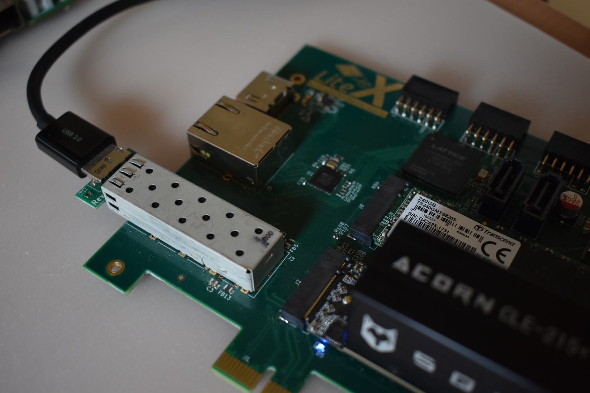
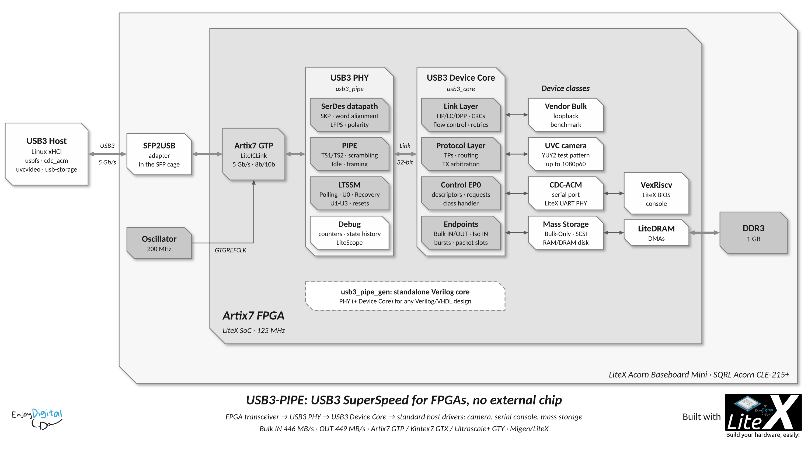
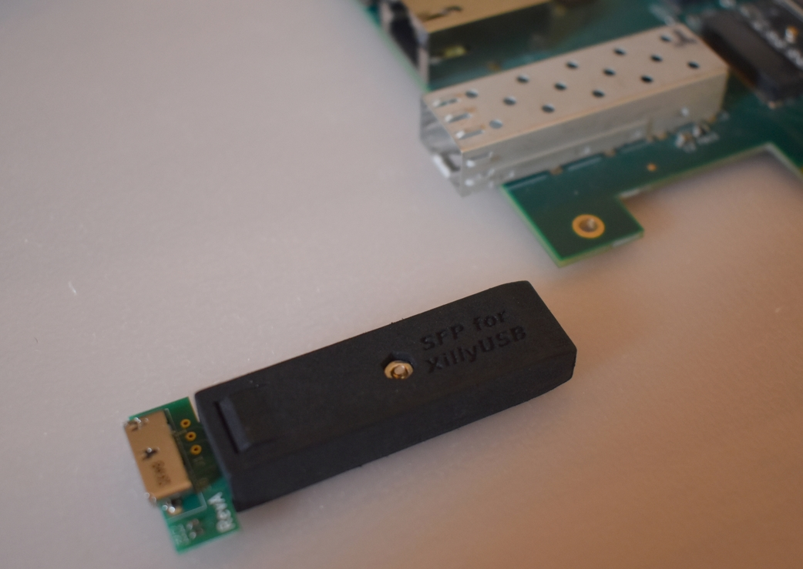

```
                         __  _________  ____    ___  _______  ____
                        / / / / __/ _ )|_  /___/ _ \/  _/ _ \/ __/
                       / /_/ /\ \/ _  |/_ <___/ ___// // ___/ _/
                       \____/___/____/____/  /_/  /___/_/  /___/
                             Copyright (c) 2019-2026, EnjoyDigital
                                      Powered by LiteX
```
[](https://github.com/enjoy-digital/usb3_pipe/actions/workflows/ci.yml)


[> Intro
--------



USB3-PIPE provides **USB 3.2 SuperSpeed (Gen 1x1, 5Gbps) and SuperSpeedPlus (Gen 2x1, 10Gbps) for
FPGAs without any external USB chip**: the FPGA transceivers are directly connected to the USB3
connector, the PHY (USB3 PIPE + LTSSM) and a complete USB3 Device Core (Link/Protocol layers,
endpoints, device classes) are implemented in the fabric, in Migen/LiteX.

Other USB3 solutions for FPGAs rely on an external PHY ([TI TUSB1310A](http://www.ti.com/product/TUSB1310A))
or an external USB controller/FIFO ([FTDI FT60X](https://ftdichip.com/products/ft600q-b/), Infineon
[FX3](https://www.infineon.com/cms/en/product/universal-serial-bus/usb-peripheral-controllers-for-superspeed/ez-usb-fx3-usb-5-gbps-peripheral-controller/)).

**Status** (USB device, SFP2USB adapter, Linux xHCI host):

| | Gen 1x1 (5Gbps): Acorn CLE-215+ (Artix7 GTP) | Gen 2x1 (10Gbps): Alibaba XCKU3P (UltraScale+ GTY) | Gen 1x1 (5Gbps): Tang Mega 138K Pro (Gowin GW5AST GTR12) |
|---|---|---|---|
| Enumeration | SuperSpeed (5000M) | SuperSpeedPlus (10000M), SuperSpeedPlus BOS capability | SuperSpeed (5000M) |
| Bulk IN/OUT | 446/449 MB/s (~90% of 5Gbps 8b/10b) | 426/466 MB/s (32-bit link), 744-785/~880 MB/s (64-bit link) | 372/433 MB/s (64-bit link at 62.5MHz) |
| Full duplex | 376 + 400 MB/s | 325 + 430 MB/s (32-bit link), 619 + 736 MB/s (64-bit link) | 262 + 383 MB/s |
| Stability | 139 GB full duplex, data checked: 0 errors, no retry/Recovery | 156 GB full duplex (64-bit link), data checked: 0 errors, 0 LBAD, 0 Recovery | 20s runs, data checked: 0 errors, 0 LBAD, 0 Recovery |
| Suspend/Resume | Linux autosuspend (U3) and resume: 72/72 clean resumes (~0.6s) | | |

Standard Linux drivers (usbfs, cdc_acm, uvcvideo, usb-storage). Demos: Bulk loopback/benchmark, LiteX
BIOS console (CDC-ACM), UVC camera up to 1080p60 (Bulk) or 1080p30 (Isochronous), Mass Storage RAM
disk (and DDR3 disk), composite camera + console.

[> Features
-----------
**PHY** (`usb3_pipe/`):
- Gen 1x1 (5Gbps): LFPS, training sequences, 8b/10b, scrambling, SKP, alignment, polarity.
- Gen 2x1 (10Gbps) on UltraScale+ GTY: SuperSpeedPlus Polling, 128b/132b, Gen 2 packet framing.
- LTSSM: Polling, U0, Recovery, U1-U3, Hot/Warm Reset, Compliance, Loopback.
- Transceivers: Artix7 GTP, Kintex7 GTX, UltraScale+ GTY, Gowin GTR12, Lattice ECP5-5G DCU.
- 32, 64 or 128-bit Link Layer interface (`link_words`); the PIPE can run in its own clock
  domain (`pipe_cd`) for slower fabrics (Gowin GW5A, Lattice ECP5).
- Also generated as a standalone Verilog core (`usb3_pipe_gen`).

**USB3 Device Core** (`usb3_core/`):
- Link Layer: header flow control, retries, LMPs, timers, SuperSpeedPlus operation.
- Protocol Layer, Control Endpoint (standard, class and vendor requests, Wishbone bridge).
- Bulk IN/OUT endpoints with bursts, Isochronous IN endpoints.
- U1/U2 Link Power Management (`with_lpm`), descriptors builder, debug traces.

**Device classes**: vendor Bulk, CDC-ACM (serial port, LiteX console), UVC (camera, Bulk or
Isochronous), MSC (mass storage on block RAM or DRAM), composite devices.

**Simulation**: Verilator Host model <-> PHYs <-> Device Core (`sim.py`), Migen tests with Python
host models (`pytest`).



*Acorn reference design (Gen 1x1 on Artix7 GTP, 32-bit Link Layer); the same PHY and core run at
Gen 2x1 on UltraScale+ GTY and on Gowin GTR12 with 64/128-bit Link Layer words.*

[> Hardware
-----------
| Board | Transceiver | Target | Status |
|---|---|---|---|
| [Acorn CLE-215+](https://github.com/enjoy-digital/litex-acorn-baseboard) on the LiteX Acorn Baseboard | Artix7 GTP | `bench/acorn.py` | Gen 1 validated, main development target |
| Alibaba Cloud XCKU3P | UltraScale+ GTY | `bench/alibaba_xcku3p.py` | Gen 1 and Gen 2 validated, main Gen 2 target |
| [Sipeed Tang Mega 138K Pro](https://wiki.sipeed.com/hardware/en/tang/tang-mega-138k/mega-138k-pro.html) | Gowin GW5AST GTR12 | `bench/sipeed_tang_mega_138k_pro.py` | Gen 1 validated |
| [LambdaConcept ECPIX-5](https://shop.lambdaconcept.com/home/46-ecpix-5.html) | Lattice ECP5-5G DCU | `bench/lambdaconcept_ecpix5.py` | Gen 1 validated: IN 434MB/s, OUT 449MB/s (on-board USB-C, open source toolchain) |
| Gowin GW5AT-15 | Gowin GTR12 | SerDes in `usb3_pipe/gw5`, no target | Gen 1 validated: IN ~400MB/s (direct USB-C) |
| [KC705](https://www.xilinx.com/products/boards-and-kits/ek-k7-kc705-g.html) | Kintex7 GTX | `bench/kc705.py` | Build-tested, hardware validation in progress |

The boards without a USB connector use a [SFP2USB](http://xillybus.com/sfp2usb-module) adapter in
a SFP cage, or the [PCIsh-to-USB3.0](doc/breakout_board.pdf) breakout board
([gerbers](doc/breakout_board_gerbers.zip)). The Gowin and ECP5 targets need the GTR12 and 40-bit
`SerDesECP5` support of [LiteICLink](https://github.com/enjoy-digital/liteiclink).



Any board with a supported transceiver routed to a SFP, PCIe or USB-C connector can be used with a
target file: the example designs are shared (`usb3_core/examples.py`). Gen 2 needs 10Gbps capable
transceivers (validated on UltraScale+ GTY).

[> Getting started
------------------
Prerequisites: Python 3.9 or newer, LiteX installed with `litex_setup.py --config=standard`
([installation guide](https://github.com/enjoy-digital/litex/wiki/Installation)), Verilator for
the simulations, Vivado or the Gowin IDE for the boards.

```sh
$ git clone https://github.com/enjoy-digital/usb3_pipe && cd usb3_pipe
$ pip3 install -e .
```

Host tools and user access to the device:

```sh
$ pip3 install pyusb libusb1
$ sudo cp bench/99-usb3-pipe.rules /etc/udev/rules.d/ && sudo udevadm control --reload
```

Simulation (Verilator): Host model <-> SerDes models <-> Device PHY + USB3 Device Core.

```sh
$ ./sim.py                         # Gen 1: link training, enumeration, Bulk transfers.
$ ./sim.py --gen2 --link-words 2   # Gen 2x1 (10Gbps) with the 64-bit Link Layer.
$ ./sim.py --help                  # Host model scenarios, pipe_cd, two lanes, VCD trace.
```

Hardware: build and load a target, check the enumeration, run a host script. The scripts given a
`--csr-csv` connect to a `litex_server` on the board bridge; `usb3_bulk.py` only needs libusb.

```sh
# Acorn CLE-215+ (Artix7 GTP, Gen 1): Bulk loopback example.
$ ./bench/acorn.py --build --load --with-jtagbone
$ lsusb -t                                           # 5000M, driver usbfs.
$ ./bench/usb3_bulk.py loopback --size 1024 --count 1000

# Alibaba XCKU3P (UltraScale+ GTY, Gen 2): bench example, 64-bit Link Layer.
$ ./bench/alibaba_xcku3p.py --build --load --example bench --gen2-capable --link-words 2
$ lsusb -t                                           # 10000M on a USB 3.2 Gen 2 root hub port, 5000M on a Gen 1 port.
$ litex_server --jtag --jtag-config <openocd config> # JTAGBone (manual: Getting started), in another terminal.
$ ./bench/usb3_bench.py both --transfer-size 65536 --csr-csv build/alibaba_xcku3p/csr.csv

# Sipeed Tang Mega 138K Pro (Gowin GW5AST GTR12, Gen 1): bench example, 64-bit Link Layer, 62.5MHz.
$ ./bench/sipeed_tang_mega_138k_pro.py --build --example bench
$ openFPGALoader -c ft2232 build/sipeed_tang_mega_138k_pro/gateware/impl/pnr/project.fs
$ litex_server --uart --uart-port /dev/ttyUSBx      # UARTBone (default bridge).
$ ./bench/usb3_bench.py both --transfer-size 65536 --csr-csv build/sipeed_tang_mega_138k_pro/csr.csv
```

`usb3_bench.py` uses 1MB transfers by default: with them the host limits the Gen 2 Bulk IN rate
(~330MB/s), `--transfer-size 65536` measures the device.

[> Demos
--------
Build with `./bench/acorn.py --build --load --example <name>`:

| Example | Device | Host side |
|---|---|---|
| `loopback` | Vendor Bulk OUT -> Bulk IN | `bench/usb3_bulk.py loopback` |
| `wishbone` | `loopback` + EP0 Wishbone bridge (vendor requests) | `litex_server --usb --usb-vid 0x1d50 --usb-pid 0x605a` |
| `bench` | Vendor Bulk counters source/checker | `bench/usb3_bench.py in\|out\|both` |
| `cdc_uartbone` | CDC-ACM serial port (UARTBone) | `litex_server --uart --uart-port /dev/ttyACM0` |
| `console` (`--cpu-type vexriscv`) | CDC-ACM LiteX BIOS console | `litex_term /dev/ttyACM0` |
| `uvc` | UVC camera, YUY2 test pattern (480p60/720p60/1080p30/1080p60) | `ffplay -f v4l2 -video_size 1920x1080 /dev/video0`, VLC |
| `uvc_iso` | UVC camera, Isochronous streaming (480p60/720p30/720p60/1080p30) | `ffplay -f v4l2 -video_size 1280x720 /dev/video0`, VLC |
| `msc` | Mass Storage 512KB FAT RAM disk | `/dev/sdX`, mount |
| `msc_dram` | Mass Storage 512MB DDR3 disk (not yet validated on hardware) | `mkfs.vfat /dev/sdX`, mount |
| `composite` (`--cpu-type vexriscv`) | UVC camera + CDC-ACM console | both at the same time |

The other targets build the same examples, except `msc_dram` (no DRAM controller). Common options:
`--link-words 1|2|4`, `--max-burst`, `--with-lpm`, `--lean`, `--with-analyzer`.

[> Standalone core generation
-----------------------------
The PHY, optionally with the Device Core (Bulk IN/OUT AXI-Stream endpoints), can be generated as a
standalone Verilog core (Gen 1x1, Artix7 GTP/Kintex7 GTX/UltraScale+ GTY) from a YAML description,
for designs not built with LiteX:
```sh
$ usb3_pipe_gen examples/a7_usb_device.yml --output-dir build/usb3_device
```
The YAML keys, interfaces and outputs are described in the Integration chapter of the manual.

[> Documentation
----------------
The **USB 3.2 PHY & Core manual** is the reference of the project, from the primers to the integration,
the examples, the debugging and the registers:

- Read it: [PDF](https://github.com/enjoy-digital/usb3_pipe/releases/download/manual-nightly/usb3_pipe_manual.pdf) or
  [HTML](https://github.com/enjoy-digital/usb3_pipe/releases/download/manual-nightly/usb3_pipe_manual.html) (rebuilt nightly).
- Sources and local build: [doc/manual](doc/manual/README.md).
- Gen 2 and multi-lane roadmap: [doc/notes/gen2-x2-roadmap.md](doc/notes/gen2-x2-roadmap.md).

[> Tests
--------
```sh
$ pytest test                                 # Default suite: Migen tests + short Verilator simulations (marker sim).
$ pytest test -n auto -m "not slow and not sim" # Without Verilator, in parallel (pytest-xdist).
$ pytest test -m slow                         # Long Verilator simulations, run nightly by the CI.
```
The CI runs the Migen tests and the Verilator simulations on every push, the long simulations
nightly.

[> Contributing
---------------
See [CONTRIBUTING.md](CONTRIBUTING.md): tests and markers, LiteX coding style, commit/pull request
rules, hardware safety rules. Pull requests go against the default branch, one topic per pull
request.

[> License
----------
USB3-PIPE is released under the very permissive two-clause BSD license. Under the terms of this
license, you are authorized to use USB3-PIPE for closed-source proprietary designs.
Even though we do not require you to do so, those things are awesome, so please do them if possible:
 - tell us that you are using USB3-PIPE
 - cite USB3-PIPE in publications related to research it has helped
 - send us feedback and suggestions for improvements
 - send us bug reports when something goes wrong
 - send us the modifications and improvements you have done to USB3-PIPE.

[> Support and consulting
-------------------------
We love open-source hardware and like sharing our designs with others.

USB3-PIPE is developed and maintained by EnjoyDigital.

If you would like to know more about USB3-PIPE or if you are already a happy user and would like to
extend it for your needs, EnjoyDigital can provide standard commercial support as well as consulting
services.

So feel free to contact us, we'd love to work with you!

[> Contact
----------
E-mail: florent [AT] enjoy-digital.fr

[> Credits
----------
- [bunnie](https://www.bunniestudios.com/) for the [PCIsh-to-USB3.0](doc/breakout_board.pdf) breakout board
  used for the initial development.
- [Antmicro](https://antmicro.com/) and [Google](https://opensource.google/) for sponsoring the initial
  development of the project.
- The [Daisho](https://github.com/greatscottgadgets/daisho) project for its USB3 core, used initially with
  USB3-PIPE ([customized](https://github.com/enjoy-digital/daisho)) before the native USB3 Device Core.
