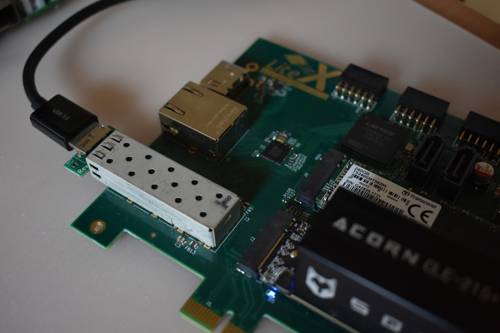
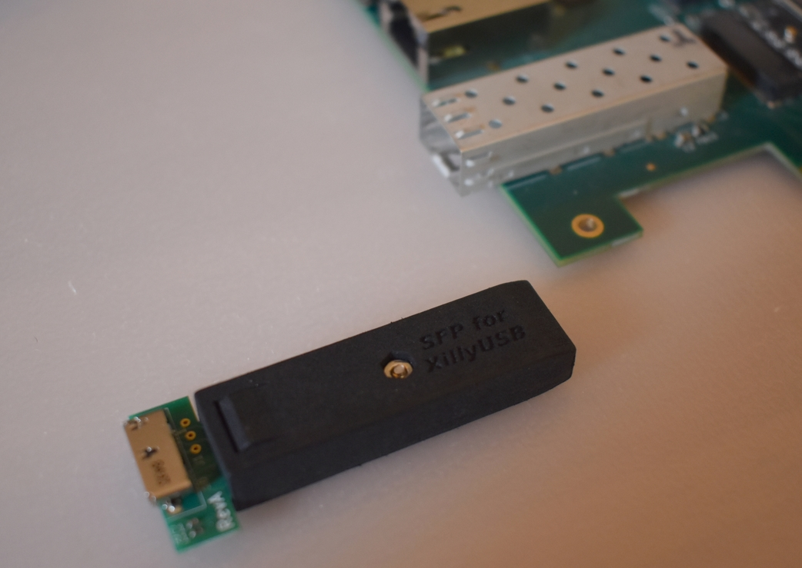

```
                         __  _________  ____    ___  _______  ____
                        / / / / __/ _ )|_  /___/ _ \/  _/ _ \/ __/
                       / /_/ /\ \/ _  |/_ <___/ ___// // ___/ _/
                       \____/___/____/____/  /_/  /___/_/  /___/
                             Copyright (c) 2019-2026, EnjoyDigital
                                      Powered by LiteX
```
[](https://github.com/enjoy-digital/usb3_pipe/actions/workflows/ci.yml)


[> Intro
--------



USB3-PIPE provides **USB3.0 SuperSpeed (5Gbps) for FPGAs without any external USB chip**: the FPGA
transceivers are directly connected to the USB3 connector, the PHY (USB3 PIPE + LTSSM) and a complete
USB3 Device Core (Link/Protocol layers, endpoints, device classes) are implemented in the fabric, in
Migen/LiteX.

Other USB3 solutions for FPGAs rely on an external PHY ([TI TUSB1310A](http://www.ti.com/product/TUSB1310A))
or an external USB controller/FIFO ([FTDI FT60X](https://ftdichip.com/products/ft600q-b/), Infineon
[FX3](https://www.infineon.com/cms/en/product/universal-serial-bus/usb-peripheral-controllers-for-superspeed/ez-usb-fx3-usb-5-gbps-peripheral-controller/)).

**Status** (USB 3.2 Gen 1x1 device, Acorn CLE-215+ (Artix7 GTP) + SFP2USB adapter, Linux xHCI host):

| | |
|---|---|
| Enumeration | SuperSpeed (5000M), standard Linux drivers (usbfs, cdc_acm, uvcvideo, usb-storage) |
| Bulk bandwidth | IN 446 MB/s, OUT 449 MB/s, full duplex 376 + 400 MB/s (~90% of 5Gbps 8b/10b) |
| Stability | 139 GB full duplex transferred with data checked: 0 errors, no retry/Recovery |
| Demos | Bulk loopback/benchmark, LiteX BIOS console (CDC-ACM), UVC camera up to 1080p60 (Bulk) or 1080p30 (Isochronous), Mass Storage RAM disk (and DDR3 disk), composite camera + console |

[> Features
-----------
- **PHY** (`usb3_pipe/`): Artix7 GTP/Kintex7 GTX/Ultrascale+ GTY SerDes (LiteICLink), LFPS, Training
  Sequences, 8b/10b, scrambling, SKP insertion/removal, word/framing alignment, polarity, LTSSM
  (Polling/U0/Recovery/U1-U3/Hot/Warm Reset/Compliance/Loopback), debug counters. Also generated as a
  standalone Verilog core (`usb3_pipe_gen`, Artix7/Kintex7/Ultrascale+).
- **USB3 Device Core** (`usb3_core/`): Link Layer (header flow control, retries, LMPs, timers), Protocol
  Layer, Control Endpoint (standard requests, alternate settings, class/vendor request handler), Bulk
  IN/OUT endpoints with bursts, Isochronous IN endpoints, U1/U2 Link Power Management (`with_lpm`, off
  by default), descriptors builder, Header Packets trace (debug).
- **Device classes**: vendor Bulk, CDC-ACM (serial port/LiteX console), UVC (video camera, Bulk or
  Isochronous), MSC (mass storage on block RAM or DRAM, ex: DDR3 through LiteDRAM), composite devices.
- **Simulation**: Verilator Host model <-> PHYs <-> Device Core (`sim.py`), Migen unit/system tests with
  Python host models (~300 tests).

```
       USB3 Host (xHCI)
             |  SuperSpeed (5Gbps)
  +----------+------------------------------------------------------------------------------+
  | FPGA     |                                                                              |
  |  +-------+-------+   +---------------------+   +--------------------------------------+ |
  |  | Transceiver   |-->| USB3 PIPE + LTSSM   |-->| USB3 Device Core                     | |
  |  | (GTP/GTX/GTY) |<--| (usb3_pipe.USB3PHY) |<--| Link -> Protocol -> EP0/Bulk/Iso EPs | |
  |  +---------------+   +---------------------+   +----+------------+------------+-------+ |
  |                                                     |            |            |         |
  |                                              CDC-ACM/UART   UVC camera   Mass Storage   |
  +-----------------------------------------------------------------------------------------+
```

[> Hardware
-----------
- [LiteX Acorn Baseboard](https://github.com/enjoy-digital/litex-acorn-baseboard) (Mini) with an Acorn
  CLE-215+ (`acorn.py`, main development/validation target).
- [KC705](https://www.xilinx.com/products/boards-and-kits/ek-k7-kc705-g.html) (`kc705.py`, Kintex7 GTX) and
  Alibaba Cloud XCKU3P board (`alibaba_xcku3p.py`, Kintex Ultrascale+ GTY): build-tested, hardware
  validation in progress.
- [SFP2USB](http://xillybus.com/sfp2usb-module) adapter (from the [XillyUSB](http://xillybus.com/xillyusb)
  project) or the [PCIsh-to-USB3.0](doc/breakout_board.pdf) breakout board.



Any 7-Series/Ultrascale+ board with a transceiver routed to a SFP/PCIe connector can be used with a target
file (the example designs are shared: `usb3_core/examples.py`).

[> Getting started
------------------
```sh
# LiteX: https://github.com/enjoy-digital/litex/wiki/Installation, Verilator (simulation), Vivado (hardware).
$ git clone https://github.com/enjoy-digital/usb3_pipe && cd usb3_pipe
$ pip3 install -e .

# Simulation: Host model <-> PHYs <-> USB3 Device Core (link training, enumeration, Bulk transfers).
$ ./sim.py
$ pytest test             # Unit/system tests (~300), pytest -n auto: parallel (pytest-xdist).
$ pytest test -m slow     # Long simulations (Verilator), not run by default.

# Hardware: build/load (JTAG) the Bulk loopback example, check the enumeration, run a loopback.
$ ./acorn.py --build --load --with-jtagbone
$ lsusb -t
$ ./scripts/usb3_bulk.py loopback --size 1024 --count 1000
```

[> Demos
--------
Build with `./acorn.py --build --load --example <name>` (`--with-lpm`: U1/U2 on the vendor Bulk
examples), see [doc/examples.md](doc/examples.md):

| Example | Device | Host side |
|---|---|---|
| `loopback` | Vendor Bulk OUT -> Bulk IN | `scripts/usb3_bulk.py loopback` |
| `bench` | Vendor Bulk counters source/checker | `scripts/usb3_bench.py in\|out\|both` |
| `cdc_uartbone` | CDC-ACM serial port (UARTBone) | `litex_server --uart --uart-port /dev/ttyACM0` |
| `console` (`--cpu-type vexriscv`) | CDC-ACM LiteX BIOS console | `litex_term /dev/ttyACM0` |
| `uvc` | UVC camera, YUY2 test pattern (480p60/720p60/1080p30/1080p60) | `ffplay -f v4l2 -video_size 1920x1080 /dev/video0`, VLC |
| `uvc_iso` | UVC camera, Isochronous streaming (480p60/720p30/720p60/1080p30) | `ffplay -f v4l2 -video_size 1280x720 /dev/video0`, VLC |
| `msc` | Mass Storage 512KB FAT RAM disk | `/dev/sdX`, mount |
| `msc_dram` | Mass Storage 512MB DDR3 disk (not yet validated on hardware) | `mkfs.vfat /dev/sdX`, mount |
| `composite` (`--cpu-type vexriscv`) | UVC camera + CDC-ACM console | both at the same time |

`kc705.py`/`alibaba_xcku3p.py` build the same examples (`--example`), except `msc_dram` (no DRAM
controller in these targets); `--with-lpm` is an `acorn.py` option.

[> Documentation
----------------
- [doc/usb3-pipe.md](doc/usb3-pipe.md): PHY (SerDes, PIPE, LTSSM, Link interface).
- [doc/usb3-core.md](doc/usb3-core.md): USB3 Device Core (Link/Protocol layers, endpoints, request
  handler, device classes, resources).
- [doc/examples.md](doc/examples.md): example designs and host tools.
- [doc/standalone-core.md](doc/standalone-core.md): standalone Verilog core generator (`usb3_pipe_gen`).
- [doc/debugging-guide.md](doc/debugging-guide.md): hardware debugging (CSRs, trace, LiteScope, soak).
- [doc/gen2-x2-roadmap.md](doc/gen2-x2-roadmap.md): Gen 2x1 (10Gbps)/Gen 1x2 (2x5Gbps) roadmap.

[> Credits
----------
- [bunnie](https://www.bunniestudios.com/) for the [PCIsh-to-USB3.0](doc/breakout_board.pdf) breakout board
  used for the initial development.
- [Antmicro](https://antmicro.com/) and [Google](https://opensource.google/) for sponsoring the initial
  development of the project.
- The [Daisho](https://github.com/greatscottgadgets/daisho) project for its USB3 core, used initially with
  USB3-PIPE ([customized](https://github.com/enjoy-digital/daisho)) before the native USB3 Device Core.
